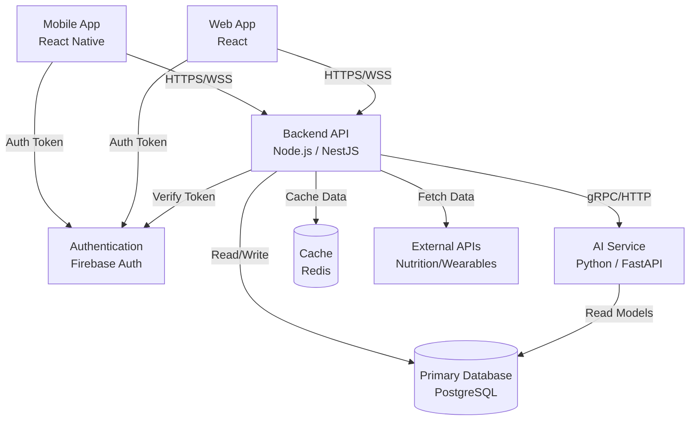

# High-Level Architecture Diagram

## Data Flows
- **Personalized Workout Plans:** The Backend API requests the AI Service to generate a plan based on user metrics stored in PostgreSQL. The AI Service processes this and returns the plan to the Backend, which caches it in Redis and sends it to the Mobile App.
- **Social Sharing:** Users submit a workout completion payload to the Backend API. The API updates the user's feed in PostgreSQL and triggers a real-time event via WebSockets to connected friends.
- **Nutrition Tracking:** Users search for food items. The Backend API queries an External Nutrition API, returns the results, and upon selection, saves the nutritional data to the user's daily log in PostgreSQL.
